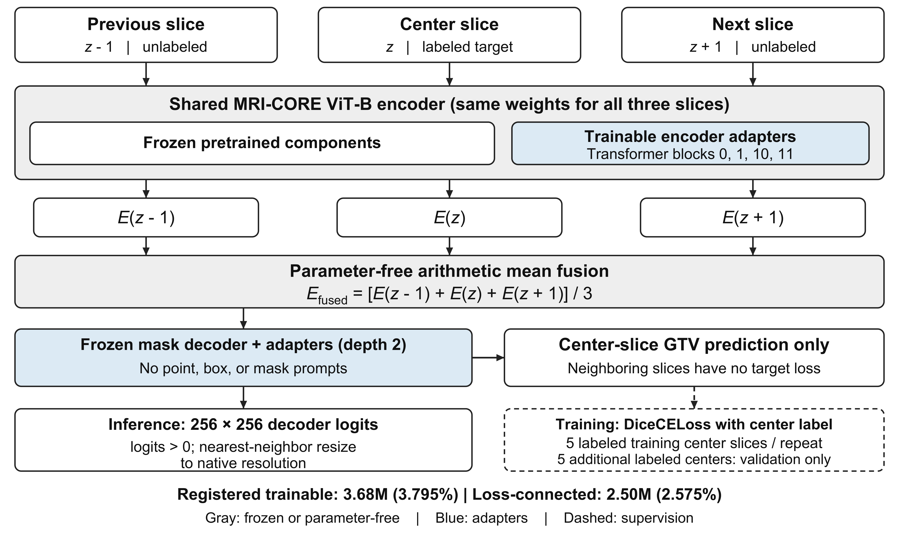
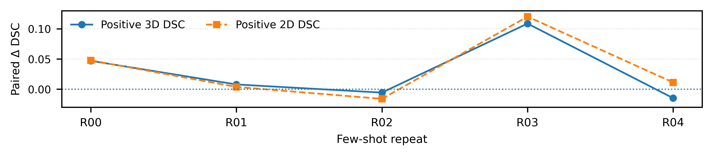

# CS-MRI-CORE

### Parameter-Efficient Cross-Slice Adaptation of an MRI Foundation Model for Extreme Few-Shot Meningioma Segmentation

**Milad Rezaei Arjmand · Mousa Shamsi**

Faculty of Biomedical Engineering, Sahand University of Technology, Tabriz, Iran

Accepted at **ICBME 2026**.

CS-MRI-CORE adapts MRI-CORE ViT-B to meningioma gross tumor volume (GTV)
segmentation in contrast-enhanced T1-weighted MRI. It shares one encoder across
three adjacent axial slices and averages their embeddings before mask decoding.
Only the center slice supplies the training target. Neighboring slices supply
unlabeled context. Adapter tuning updates 3.68 million of 97.04 million
parameters (3.795%) without introducing a trainable 3D backbone.



**Supervision budget per repeat:** five labeled training center slices **plus
five separately labeled validation center slices**. The validation labels are
additional supervision used for checkpoint selection.

## What this repository contains

- The Single-Slice MRI-CORE training route and the three-slice mean-fusion route.
- Shared spatial augmentation for adjacent slices and the center target.
- Original preprocessing and locked five-repeat full-volume evaluation code,
  with paths redirected to an isolated local workspace.
- Published aggregate and repeat-level results, architecture assets, protocol
  settings, and source provenance.

MRI-CORE/SAM code and weights, medical data, private manifests, case-level
outputs, and trained checkpoints are acquired separately. These external
artifacts are not downloadable from this repository.

## Published results

Final holdout: **50 cases, 7,928 slices**, evaluated after protocol lock. Table
entries are mean ± sample SD across **five paired support repeats** (00-04).

| Metric | Single-Slice MRI-CORE | CS-MRI-CORE |
|:--|--:|--:|
| Positive-slice-only 3D Dice | 0.4474 ± 0.0760 | 0.4760 ± 0.0570 |
| Case-wise mean 2D Dice on reference-positive slices | 0.4033 ± 0.0659 | 0.4367 ± 0.0479 |
| Full-volume Dice | 0.2243 ± 0.0307 | 0.2234 ± 0.0433 |
| HD95 (mm) | 112.44 ± 4.27 | 114.98 ± 4.69 |
| False-positive reference-negative slices | 5786.4 ± 378.7 | 6145.8 ± 310.0 |
| Missed reference-positive slices | 28.0 ± 14.8 | 15.4 ± 10.4 |

The paired mean gains were **+2.86 Dice percentage points** for positive-slice-only
3D Dice and **+3.34 points** for case-wise positive 2D Dice. Exact two-sided
Wilcoxon tests used the repeat as the unit (`n = 5`): `W = 4, p = 0.4375` and
`W = 3, p = 0.3125`, respectively. Neither result was statistically significant.
Full-volume Dice was essentially unchanged. Fewer positive slices were missed,
while false-positive slices and HD95 increased. These are not claims of clinical
benefit or superiority over differently evaluated literature methods.



Machine-readable values: [aggregate](results/published_aggregate.json) and
[paired repeats](results/published_per_repeat.csv). No new experiments were run
to prepare this repository.

## Installation

Python 3.12 and a CUDA-capable PyTorch environment are recommended by the
upstream setup. Use a fresh environment inside this separate checkout:

```bash
python -m venv .venv
# Linux / WSL
source .venv/bin/activate
# Windows PowerShell alternative: .\.venv\Scripts\Activate.ps1
python -m pip install --upgrade pip
python -m pip install torch==2.6.0 torchvision==0.21.0 --index-url https://download.pytorch.org/whl/cu124
python -m pip install -r requirements.txt
```

The dependency specification is a suggested setup based on upstream guidance,
**not** a verified historical environment lock. Dataset/GPU model execution has
not been validated in this preparation environment. The upstream loader uses
CUDA for pretrained loading; CPU-only metric tests do not test that loader.

Obtain MRI-CORE directly from its maintainers after checking its terms:

```bash
git clone https://github.com/mazurowski-lab/mri_foundation.git .external/mri_foundation
git -C .external/mri_foundation checkout 0f4f452614013873f8bb58a1fd613dbe36b58aba
python scripts/check_upstream.py
```

All recorded upstream file hashes matched this remote commit during preparation.
The local hash checker must still pass before model execution. If the check
fails, resolve the mismatch against the recorded hashes before reproduction.

Follow the official [MRI-CORE instructions](https://github.com/mazurowski-lab/mri_foundation)
to acquire initialization weights. The existing model builder requires both
`mri_foundation.pth` and `sam_vit_b_01ec64.pth` under the dependency's
`pretrained_weights/` folder. No weights are provided or automatically downloaded
by this release's launcher.

## Data preparation

Request BraTS-MEN-RT through the [official Synapse record](https://doi.org/10.7303/syn59059779).
Respect its access and redistribution conditions. Read
[data layout and exact-replay requirements](docs/DATA_AND_REPRODUCTION.md)
before supplying any inputs.

Put authorized local inputs in ignored `.runtime/`. The original scripts require
the split CSV, few-shot master manifest, and the original locked final-holdout
manifest. These patient-selection artifacts are not distributed here. A checksum
alone cannot reconstruct them, so exact replay is unavailable from this public
checkout alone.

## Commands

Commands below **print a plan by default**. Append `--execute` only when running
your own separate authorized workspace with all required inputs. Do not use
the scientifically locked archive as a writable execution directory.

```bash
# Initial center/context and development-volume cache
python scripts/run.py preprocess
# Locked final-volume cache, after the initial cache and lock inputs exist
python scripts/run.py preprocess-final
# Five training centers plus five validation centers, per support repeat
python scripts/run.py train --method single --repeat 0
python scripts/run.py train --method cross --repeat 0
# Repeat with --repeat 1, 2, 3, 4 for the other predefined support sets
# Verify locked manifests and construct the evaluation list
python scripts/run.py prepare-evaluation
# Evaluate BOTH methods across all five repeats with the original lock checks
python scripts/run.py evaluate
```

For example, actual cross-slice training on a separate prepared workspace uses
`python scripts/run.py train --method cross --repeat 0 --execute`.
The evaluation command requires the ten private few-shot manifests for leakage
checks and the five paired trained checkpoints. It retains the original `logit > 0`
threshold, binary nearest-neighbor resizing, native-volume metric definitions,
and boundary replication. It does not tune thresholds or add post-processing.

## Tests and verification limits

```bash
python -m pip install -r requirements-test.txt
python -m unittest discover -s tests -v
```

Tests use synthetic arrays and published aggregate data. They check metric
empty-mask behavior, physical-spacing HD95, the exact paired test, retained
scientific settings, syntax, isolated paths, launcher plans, and reported table
rounding. They do not train a model, access medical images, load checkpoints,
or reevaluate the locked holdout. See [portability notes](docs/PORTABILITY.md).

## Structure

```text
assets/       Architecture SVG/PNG and aggregate repeat plot
configs/      Locked scientific settings and upstream file hashes
docs/         Reproduction, portability, and provenance notes
results/      Published aggregate and paired-repeat values only
scripts/      Training, preprocessing, evaluation, and safe launcher
tests/        Synthetic and static release checks
.external/    Separately acquired dependencies/weights (ignored, absent)
.runtime/     Authorized local data, manifests, and outputs (ignored, absent)
```

## Limitations

Results depend on support selection and are based on five paired repeats, one
T1c meningioma task, and an internal holdout from the same dataset cohort.
There is no external validation or matched fully 3D comparator. Lesion-focused
mean gains were nonsignificant and accompanied by increased false-positive
slices and HD95. The data, manifests, checkpoints, and historical compute
environment needed for exact score replay are not bundled.

## Citation and acknowledgments

```bibtex
@unpublished{rezaeiarjmand2026csmricore,
  title = {CS-MRI-CORE: Parameter-Efficient Cross-Slice Adaptation of an MRI Foundation Model for Extreme Few-Shot Meningioma Segmentation},
  author = {Milad Rezaei Arjmand and Mousa Shamsi},
  year = {2026},
  note = {Accepted at ICBME 2026}
}
```

The paper DOI and final proceedings metadata are not yet recorded here.
Please also acknowledge [MRI-CORE, Dong and colleagues](https://arxiv.org/abs/2506.12186),
[BraTS-MEN-RT](https://doi.org/10.1038/s41597-026-06649-x), and
[Segment Anything](https://github.com/facebookresearch/segment-anything).

## License and availability

Original CS-MRI-CORE Python code in `scripts/` and `tests/` is covered by the
[MIT license](LICENSE). Figures in `assets/` are excluded from that software
license; no separate reuse license for the figures is granted here. Existing
license grants for previously published repository material remain unchanged.

Third-party code, weights, datasets, and publication materials retain their
own terms. The MRI-CORE README references Apache 2.0, but its inspected tree
lacks the linked license file; upstream code and weights are therefore not
redistributed. See [licensing scope and third-party notices](THIRD_PARTY_NOTICES.md).
Obtain medical data from its official provider.
